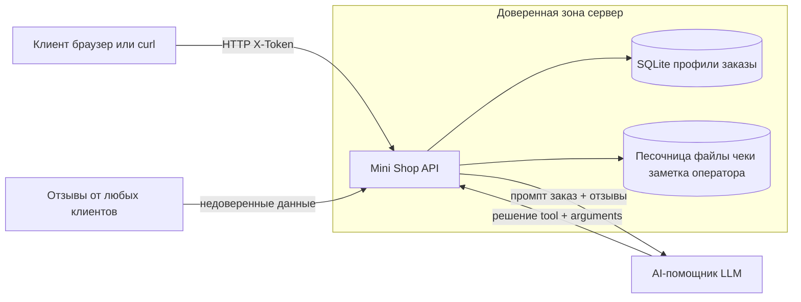

# Модель угроз Mini Shop

Ориентир по порядку как в threat modeling от Microsoft: описать систему, найти угрозы,
меры защиты, проверка.

## Система

Mini Shop это локальный HTTP API магазина на Python (стандартная библиотека, SQLite в памяти,
временные файлы в песочнице). Пользователи: клиенты alice и bob, сотрудник staff. Вход по
паролю дает токен, токен передается в заголовке X-Token. Есть AI-помощник: сервер собирает
промпт из заказа и отзывов, модель возвращает решение (какой инструмент вызвать), сервер
выполняет инструмент (read_file, export_profiles, delete_tree).

## Схема и границы доверия

Главное: все, что приходит от клиента (параметры, заголовки, тело, отзывы и решение модели),
это недоверенный вход. Решения по правам принимает сервер по своей сессии, а не клиент и не
модель.

## Угрозы (по смыслу STRIDE)

| Угроза | Где | Тип | Разбор |
|---|---|---|---|
| Подмена роли заголовком X-Role | /admin/export | Spoofing / Elevation | клиент объявляет себя staff |
| Чужой профиль и файлы по id/user | /profile, /files | Information disclosure | нет проверки владельца |
| SQL-инъекция | /profile, /search | Tampering | ввод подставлялся в SQL строкой |
| Своя цена заказа | /orders POST | Tampering | price берется из тела |
| Утечка паролей и токенов | /debug/logs | Information disclosure | журнал открыт и хранит секреты |
| XSS в отзывах | /reviews/view | Tampering | текст без экранирования в HTML |
| Prompt injection через отзыв | /assistant/context | Tampering | данные вклеены как инструкции |
| Исполнение инструмента без прав | /assistant/execute | Elevation | нет токена и проверки прав |

## Меры защиты

- Авторизация и владелец по сессии сервера, а не по заголовкам клиента.
- Параметризованные SQL-запросы.
- Цена только из каталога.
- Журнал только для сотрудника и без тел и заголовков.
- Экранирование вывода в HTML.
- Отзывы помечены как недоверенные данные в промпте.
- Права на инструменты помощника проверяет сервер после решения модели.

## Проверка

На каждую угрозу есть тест в lab/test_security.py. На исходном сервисе 11 тестов падают,
после исправлений проходят. make test зеленый (27 тестов). Подробности в REPORT_01 и REPORT_02.
